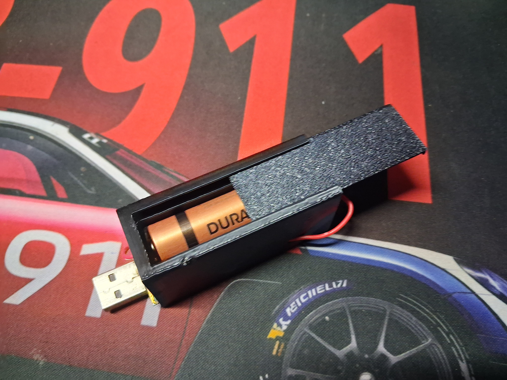
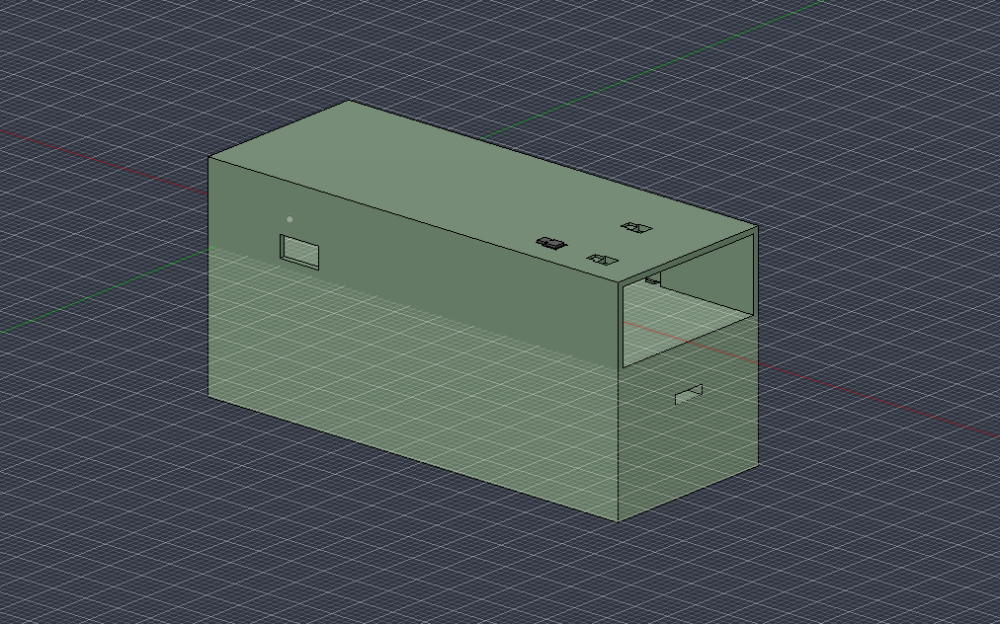

# GoGear-SA1100-AA-Battery-Mod
Custom case for Philips GoGear SA1100 with AA battery adaptation.
Usually, you need to use AAA battery in this mp3 player, but I have designed a case, which allows you to use a AAA battery instead, AAA drains faster, AA battery gives it a longer battery life. (and I broke my original case ;P)
## Inspiration
I found this mp3 player, in scrap, original owner threw it because its case was broken, using it was super hard. I talked to them, they said I could have it.
They said it lasted like only a few hours, on a AAA battery. So I decided to make a case for it, which allows me to add a AA battery for longer battery life.
## Images
### IRL images:
 
### Fusion 360 render
  
### Slicer render

## Printing slicer settings (recommended)
## Printing slicer settings (recommended)

The following settings are recommended for a reliable, functional print. They prioritize dimensional accuracy, strength and a clean finish.

| Setting | Recommended value |
|---|---|
| Printer | Bambu Lab A1 |
| Nozzle | 0.4 mm |
| Material | PLA / PLA+ |
| Layer height | 0.20 mm |
| Initial layer height | 0.20 mm |
| Wall loops | 4 |
| Top shell layers | 5 |
| Bottom shell layers | 5 |
| Infill density | 25–30% |
| Infill pattern | Gyroid |
| Supports | Enable only where required |
| Support type | Tree (Auto) |
| Build plate adhesion | Brim if needed |
| Print speed | Default / Standard |

**Note:** These are starting recommendations. Actual settings may need adjustments depending on filament, printer.

